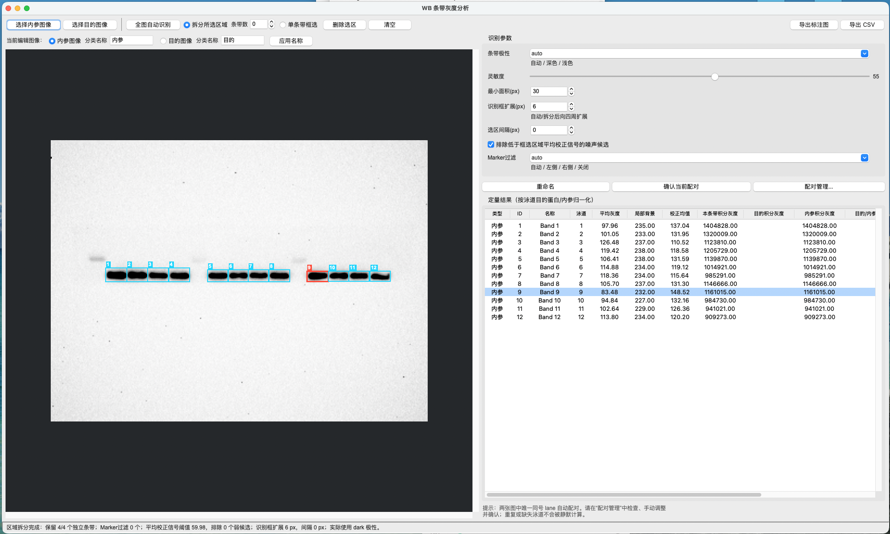

# Western Blot Band Analysis

**A local, Python-based desktop application for Western blot band detection, background-corrected densitometry, and target/reference protein normalization.**

[English](README.md) | [简体中文](README.zh-CN.md)

Western Blot Band Analysis helps biomedical researchers quantify Western blot images using automatically detected or manually adjusted regions of interest (ROIs). It provides separate workspaces for target and loading-control images, lane-based band matching, inspectable quantification results, and exports suitable for downstream analysis.

The software runs locally on **Windows and macOS**. Images do not need to be uploaded to an online service.

> **Interface language:** The current desktop GUI uses Chinese labels. This README provides English documentation; an English-language GUI is not yet included. The workflow below gives the corresponding Chinese button labels.

## Screenshot



## Why this project?

Western blot analysis is routine in biomedical laboratories, but drawing band boundaries, subtracting background, and matching targets to loading controls can be time-consuming and prone to inconsistent manual decisions.

This project provides an accessible workflow that combines automated detection with user review. It makes the selected ROIs, numerical measurements, pairing decisions, and potential matching problems visible rather than hiding them behind a single final ratio. The source code and tests can be inspected and extended by other researchers.

## Key features

### Band detection and ROI editing

- Import **PNG, JPEG, TIFF, and BMP** images.
- Detect dark or light bands, with automatic polarity inference or manual selection (`auto`, `dark`, `light`).
- Detect bands across an entire image, with adjustable sensitivity and minimum band area.
- Split a selected region into individual bands; optionally provide the expected number of bands (`0` = automatic).
- Use row projections, peak/valley checks, and neighboring-band geometry to help distinguish closely spaced bands from texture within a single band.
- Adjust ROI expansion and spacing to reduce overlap between adjacent regions.
- Filter molecular-weight marker lanes (`auto`, `left`, `right`, `off`).
- Draw, select, rename, and delete individual band ROIs.

### Densitometry and normalization

- Quantify bands using a **local background ring** around each ROI.
- Report mean grayscale intensity, local background, background-corrected mean, and integrated density.
- Analyze target and reference/loading-control images independently while retaining their ROIs.
- Automatically pair bands when a lane contains exactly one eligible target and one eligible reference band with the same lane number.
- Calculate **target integrated density / reference integrated density** for valid pairs.
- Review and confirm matches or manually reassign a target to a reference band, including across lane numbers.
- Explicitly flag missing bands, ambiguous lanes, duplicate reference assignments, and zero-intensity references instead of silently reporting invalid ratios.

### Reviewable results and export

- Inspect band-level measurements and lane-pairing diagnostics in the GUI.
- Export a **CSV** containing image names, target/reference categories, ROI coordinates, grayscale measurements, integrated densities, normalized ratios, pairing statuses, and reasons for missing or invalid values.
- Export annotated images with ROI outlines and labels.
- Open the exported CSV in Excel or process it with statistical software or Python/R.

## Getting started

### Requirements

- **Python 3.10 or later** if installing manually (the provided setup scripts can install Python 3.12 where needed).
- A desktop environment with **Tkinter** support.
- Python libraries installed via `requirements.txt`: NumPy, SciPy, scikit-image, and Pillow.

### macOS: launcher scripts

1. Download the repository as a ZIP and extract it, or clone it using Git.
2. Double-click `MACOS-1-安装依赖.command` to configure Python, Tkinter, a virtual environment, and the required packages. If needed, the setup script uses Homebrew to install Python 3.12 and Tkinter.
3. Double-click `MACOS-2-启动WB分析.command` to launch the program.

Alternatively, after installation:

```bash
.venv/bin/python run_wb.py
```

If macOS reports that the scripts are not executable, run:

```bash
chmod +x MACOS-1-安装依赖.command MACOS-2-启动WB分析.command
```

### Windows: launcher scripts

1. Download and extract the repository, or clone it using Git.
2. Double-click `WINDOWS-1-安装依赖.bat` to set up Python and the required packages.
3. Double-click `WINDOWS-2-启动WB分析.bat` to open the GUI.

The Windows installer script uses an existing supported Python installation when available or attempts to install Python 3.12 when needed. See [WINDOWS.md](WINDOWS.md) for Windows-specific troubleshooting (currently in Chinese).

### Manual installation (Windows or macOS)

With Python and Tkinter available, open a terminal in the project directory:

```bash
python -m pip install -r requirements.txt
python run_wb.py
```

On Windows, `py -3` may be used in place of `python`. If the GUI fails to open, check that your Python installation includes Tkinter and that you are running in a desktop session.

## Typical analysis workflow

**Example:** Quantify AKT as the target protein and GAPDH as the loading control.

1. **Load the images.** Click **选择目的图像** (*Select target image*) and **选择内参图像** (*Select reference image*). Each image has its own ROI set.
2. **Label the proteins.** Enter `AKT` and `GAPDH` in their respective **分类名称** (*Category name*) fields, then click **应用名称** (*Apply names*).
3. **Detect bands.** Start with band polarity `auto`, then click **全图自动识别** (*Detect entire image*). Adjust sensitivity and minimum area as needed.
4. **Refine difficult bands.** Select **拆分所选区域** (*Split selected region*) and draw a rectangle over a row of bands. Leave the expected count at `0` for automatic detection, or enter a positive number when you know the number of bands. Use **单条带框选** (*Single-band ROI*) to add or correct individual bands.
5. **Inspect the boundaries.** Confirm that each ROI captures the intended band without extending into an adjacent lane. Adjust ROI expansion, spacing, polarity, or marker filtering when necessary.
6. **Review target/reference matching.** Open **配对管理…** (*Pairing manager*). Unique, corresponding lane numbers are matched automatically. Confirm correct pairs or manually choose a different reference band when the separately detected lane numbers do not align.
7. **Inspect the results.** Review each band's integrated density, the normalized target/reference ratio, and any pairing or missing-data warnings.
8. **Export.** Click **导出 CSV** (*Export CSV*) for the quantitative data. Use **导出标注图** (*Export annotated image*) to save the current image with ROI outlines and names.

A reference band can be assigned to only one target band at a time. If a pair cannot be resolved, the CSV retains a diagnostic `pairing_status` and `missing_reason` rather than inventing a ratio.

## How quantification works

For each rectangular band ROI, the application estimates background as the **median grayscale intensity of pixels in a surrounding rectangular ring**, excluding the ROI itself.

Let `G(p)` be the grayscale value of pixel `p`, and let `B` be that local background estimate. The background-corrected integrated density is:

**Dark bands on a light background:**

```text
Integrated density = sum(max(B - G(p), 0))  for pixels p in the ROI
```

**Light bands on a dark background:**

```text
Integrated density = sum(max(G(p) - B, 0))  for pixels p in the ROI
```

For a valid target/reference pair:

```text
Normalized target intensity =
    target_integrated_density / reference_integrated_density
```

The analysis operates on **8-bit grayscale representations** of the imported images. The target/reference ratio is a relative densitometric measurement, not an absolute protein concentration.

## Understanding the CSV export

The export contains one record per target/reference pairing result, including unresolved entries. Selected fields include:

| Field | Meaning |
| --- | --- |
| `lane`, `target_lane`, `reference_lane` | Assigned lane identifiers |
| `target_category`, `reference_category` | User-entered protein/category names |
| `target_image`, `reference_image` | Source image filenames |
| `target_x`, `target_y`, `target_width`, `target_height` | Target ROI coordinates in original-image pixels |
| `reference_x`, `reference_y`, `reference_width`, `reference_height` | Reference ROI coordinates in original-image pixels |
| `target_integrated_density` | Background-corrected target band signal |
| `reference_integrated_density` | Background-corrected loading-control band signal |
| `target_over_reference` | Target/reference ratio, if valid |
| `pairing_status` | Automatic, manual, confirmed, or diagnostic status |
| `missing_reason` | Explanation when a band or valid match is unavailable |

The CSV is written in UTF-8 with a byte-order mark to improve compatibility with Excel.

## Scientific use and limitations

- **Inspect all automatically detected ROIs and lane assignments.** Weak, saturated, blurred, overlapping, or unevenly exposed bands may need manual review.
- Use images obtained within the appropriate linear detection range and apply a consistent acquisition and normalization strategy when comparing samples.
- The program provides densitometric measurements; experimental normalization, biological replication, statistics, and conclusions remain the researcher's responsibility.
- The included automated tests cover software behavior using defined and synthetic examples; they do not by themselves establish validation against every experimental imaging system.
- This is a research analysis utility, **not a clinical diagnostic device**.

## Project structure

```text
western-blotting-analysis/
├── README.md                    # English documentation
├── README.zh-CN.md              # Chinese documentation (preserve existing README)
├── LICENSE                      # MIT license (add when publishing)
├── wb_analysis.py               # Band detection and numerical quantification
├── wb_gui.py                    # Tkinter desktop interface
├── run_wb.py                    # Application entry point
├── requirements.txt             # Python dependencies
├── tests/
│   └── test_wb_analysis.py      # Automated tests
├── docs/
│   └── images/
│       └── wb-gui-overview.png  # GUI screenshot
├── WINDOWS.md                   # Windows usage and troubleshooting (Chinese)
├── MACOS-1-安装依赖.command
├── MACOS-2-启动WB分析.command
├── WINDOWS-1-安装依赖.bat
└── WINDOWS-2-启动WB分析.bat
```

## Development and testing

Core detection and quantification routines are implemented in `wb_analysis.py` separately from the Tkinter GUI in `wb_gui.py`. This separation makes the numerical routines easier to test and adapt.

To run the existing Python tests, install `pytest` in addition to the application requirements:

```bash
python -m pip install -r requirements.txt
python -m pip install pytest
python -m pytest -q
```

## Contributing and reporting issues

Bug reports, reproducible sample cases, feature suggestions, and pull requests are welcome. Please open a [GitHub issue](https://github.com/yxr191202/western-blotting-analysis/issues) and include your operating system, Python version, the steps to reproduce the problem, and a description of the expected behavior. Remove patient identifiers or other sensitive information from example images before sharing them.

## Citation

If this software is useful in your research, consider referencing the repository and the specific version or commit used:

> Western Blot Band Analysis. GitHub repository: https://github.com/yxr191202/western-blotting-analysis (accessed YYYY-MM-DD; commit SHA or release version).

## License

This project is distributed under the **MIT License**. See [LICENSE](LICENSE) for the license terms.
